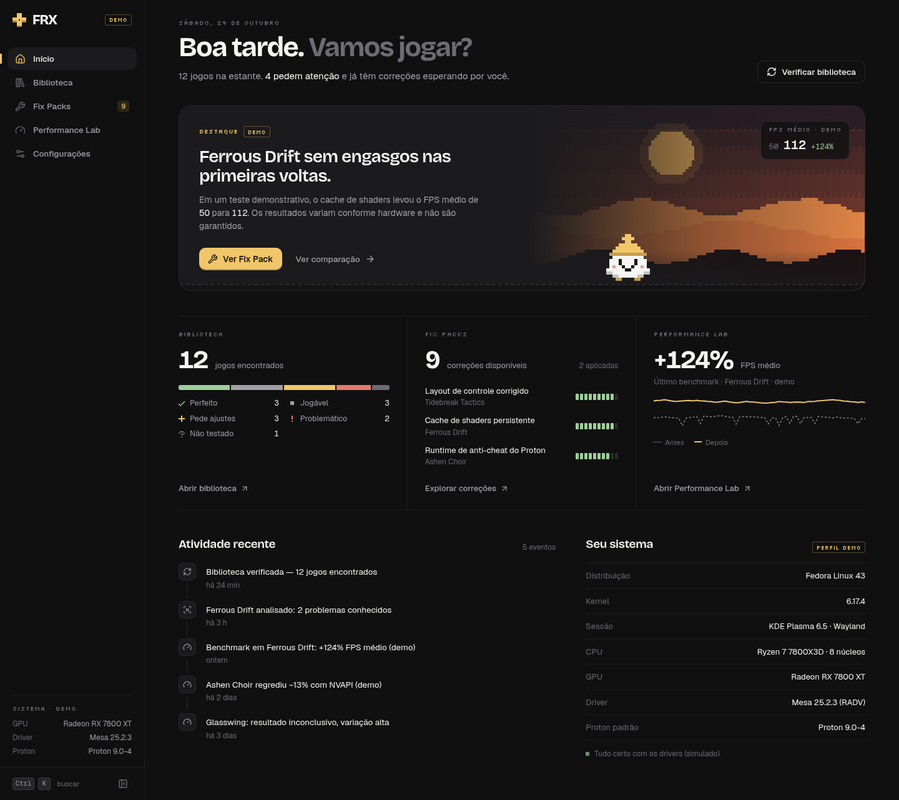

<p align="center">
  
  <br>
  <strong>Olá! Bem-vindo ao FRX.</strong>
</p>

# FRX — Play. Fix. Repeat.

**FRX** é uma central de diagnóstico, compatibilidade e resolução de problemas de jogos Windows no Linux (Steam, Proton e Wine).

**Versão 0.5.0:** no app desktop, o FRX detecta os jogos instalados pela Steam, pesquisa correções específicas de **jogo, GPU, driver e Proton**, mede o desempenho com logs reais do **MangoHud** e **aplica correções** pelo **Fix Engine**. Receitas revisadas ou geradas a partir das descobertas usam prévia calculada no Rust, backups verificados, escrita atômica por arquivo, conferência no disco, histórico persistente e rollback que preserva mudanças de terceiros. A classe inicial de correções externas permite baixar e instalar configurações UTF-8 com origem, integridade, destino e requisitos verificáveis.

> O gerador reconhece variáveis permitidas e arquivos de configuração suportados publicados por fontes reconhecidas. Downloads exigem confirmação e passam por staging e validação antes da instalação. DLLs, executáveis, scripts, Winetricks, registro e procedimentos incompletos permanecem em revisão, com o motivo. Nenhum script de terceiros é executado e não há sudo automático. Com a Steam aberta, alterações só de opções de inicialização podem seguir o passo manual; operações por arquivo aguardam seu fechamento. No navegador (`npm run dev:web`), os dados e as aplicações são demonstrativos.

## Resolution Center — v0.5

A página de cada jogo agora reúne **diagnóstico, tecnologias, fontes e planos de resolução**, usando o Fix Engine existente. Não é necessário que uma correção aumente FPS: compatibilidade, estabilidade, física e recursos gráficos têm objetivos próprios.

- **Diagnosticar** inspeciona a instalação e o ambiente sem alterar o jogo. DLLs são indícios; suporte do hardware, configuração e observação em execução aparecem separados.
- **Pesquisar soluções** consulta documentação dos mantenedores e relatos verificáveis do mesmo AppID. Cache permite continuar consultando dados disponíveis offline, com limitações explícitas.
- **Importar log deste jogo** analisa somente o arquivo escolhido, com até 2 MiB e AppID correspondente; o texto bruto e caminhos pessoais não são persistidos no diagnóstico.
- Planos suportados abrem a prévia existente: **confirmar → aplicar → conferir → manter ou desfazer**. Receitas são revalidadas no núcleo; fonte externa não autoriza comandos.
- **Configuração conferida** confirma o estado no disco, não que um crash desapareceu ou que DLSS/PhysX/FG funcionou. Desempenho continua sendo medido no Performance Lab.

Há diagnóstico conservador para PhysX, DLSS/DLAA, frame generation, FSR, XeSS, ray tracing, pilha gráfica, áudio/vídeo, controles e estabilidade. A capacidade de observar cada recurso varia: FPS do MangoHud não comprova quadros gerados ou latência. Troca de Proton, DLLs e mecanismos de atualização de componentes sem rollback específico permanecem **Requer revisão**, inclusive as opções GE-Proton documentadas. O patch PhysX histórico do Batman continua não identificado.

Arquitetura: [Resolution Intelligence](docs/RESOLUTION-INTELLIGENCE.md). Fontes e limites: [diagnósticos gráficos e de física](docs/GRAPHICS-PHYSICS-DIAGNOSTICS.md). Resultados verificáveis: [validação da v0.5](docs/VALIDACAO-v0.5.md).

## Prévia



*Captura da interface v0.2 em modo demonstrativo. Jogos, hardware e resultados exibidos nesta imagem são fictícios.*

## Como executar

O FRX é um **aplicativo desktop Linux** feito com **Tauri 2** (Rust) e uma interface em React + TypeScript + Vite.

### Dependências de compilação

- Node 20.19+ ou 22.12+ (testado com Node 24) e npm
- Rust **1.88+** (testado com 1.97) via [rustup](https://rustup.rs); a dependência de ZIP é `zip` 9.1.1
- Bibliotecas do sistema para o WebKitGTK:

| Distribuição | Comando |
| --- | --- |
| Arch / CachyOS / Manjaro | `sudo pacman -S --needed webkit2gtk-4.1 gtk3 base-devel curl wget file openssl librsvg` |
| Debian / Ubuntu | `sudo apt install libwebkit2gtk-4.1-dev libgtk-3-dev build-essential curl wget file libssl-dev librsvg2-dev` |
| Fedora | `sudo dnf install webkit2gtk4.1-devel gtk3-devel openssl-devel curl wget file librsvg2-devel && sudo dnf group install c-development` |

Opcionais: `libappindicator-gtk3` (bandeja do sistema, ainda não usada) e `fuse2` (para abrir o AppImage sem extraí-lo; sem ele, use `APPIMAGE_EXTRACT_AND_RUN=1`).

Para **capturar** benchmarks, instale o MangoHud e a biblioteca da arquitetura do jogo. No Arch/CachyOS: `sudo pacman -S --needed mangohud lib32-mangohud`. O FRX apenas mostra essa orientação; não instala pacotes. A captura foi validada com MangoHud **0.8.4**, Vulkan, NVIDIA RTX 4060 e Hyprland/Wayland. A importação de logs existentes funciona mesmo sem MangoHud instalado.

### Comandos

```bash
npm install
npm run dev            # abre a janela do FRX (Tauri + Vite com recarga ao vivo)
npm run build          # binário de release + AppImage, .deb e .rpm
npm run build:appimage # só o AppImage
npm run build:arch     # pacote nativo do pacman (Arch/CachyOS)
npm run dev:web        # apenas a interface no navegador, em http://localhost:1420
npm run build:web      # verifica o TypeScript e compila a interface
npm run typecheck
npm test               # testes do front-end (Vitest)
(cd src-tauri && cargo test)            # testes do Rust (com fixtures, sem rede)
(cd src-tauri && cargo fmt --check && cargo clippy --all-targets -- -D warnings)
```

Onde ficam os artefatos:

```
src-tauri/target/release/frx                                   binário
src-tauri/target/release/bundle/appimage/FRX_0.5.0_amd64.AppImage
src-tauri/target/release/bundle/deb/FRX_0.5.0_amd64.deb
src-tauri/target/release/bundle/rpm/FRX-0.5.0-1.x86_64.rpm
packaging/arch/frx-bin-0.5.0-1-x86_64.pkg.tar.zst             (sudo pacman -U …)
```

Na build de release, a interface (`dist/`) é **embutida no binário** e servida pelo protocolo interno do Tauri. Não é preciso um servidor Vite. O Vite só é usado em `npm run dev`, pela `devUrl` `http://localhost:1420`.

### Integração com o desktop

- Janela nativa com título "FRX", 1440×900, tamanho mínimo de 1024×700 e fundo `#101011` (sem flash branco ao abrir).
- O app id e a classe da janela são `frx`. Os arquivos `.desktop` usam `StartupWMClass=frx`, então o ícone aparece certo na barra de tarefas, tanto em Wayland quanto em X11.
- O ícone vem de `packaging/icon.svg` (o mesmo símbolo d-pad da interface). Para regenerar, rode `npx tauri icon packaging/icon.png -o src-tauri/icons`.
- **Gerenciadores de janela em mosaico** (Hyprland, Sway…) podem ignorar o tamanho mínimo. Para abrir o FRX flutuando, adicione uma regra para a classe `frx` no seu WM.
- **WebKitGTK + NVIDIA no Wayland:** o app define `WEBKIT_DISABLE_DMABUF_RENDERER=1` ao iniciar, a menos que você já tenha definido essa variável. Isso evita a janela em branco conhecida nessa combinação.

### Ponte TypeScript ↔ Rust

| Comando | Para que serve |
| --- | --- |
| `scan_installed_games` | Varre a Steam (assíncrono) e salva o resultado em cache |
| `get_installed_games` | Última varredura salva, para mostrar a biblioteca na hora |
| `get_system_profile` | Distribuição, kernel, sessão, CPU, RAM, GPUs, driver e versão |
| `get_game_art` | Capa, banner ou cabeçalho do jogo, com cache local |
| `search_game_fixes` | Pesquisa correções de um AppID em todos os provedores |
| `get_cached_fix_reports` | Relatórios salvos, funciona sem conexão |
| `get_fix_providers`, `clear_fix_cache`, `get_cache_size` | Configurações de fontes e de cache |
| `app_info`, `ping` | Informações do app e teste da ponte |
| `detect_mangohud` | Executável, versão, camadas Vulkan e bibliotecas de 32/64 bits |
| `import_benchmark`, `list_benchmark_sessions`, `get_benchmark_session` | Importação, histórico persistente e séries temporais |
| `compare_benchmark_sessions`, `update_benchmark_session`, `delete_benchmark_session`, `export_benchmark_session` | Comparação e gerenciamento de sessões |
| `prepare_benchmark`, `start_capture`, `get_capture_status`, `capture_logging`, `finish_capture`, `cancel_capture`, `reset_capture` | Captura assistida e controle do MangoHud |
| `get_fix_engine_status`, `list_fix_recipes`, `get_fix_recipe`, `check_fix_compatibility` | Catálogo local e compatibilidade (somente leitura) |
| `analyze_fix_findings` | Gerador dinâmico: categoria, motivo e receita gerada de cada descoberta (não grava no jogo) |
| `get_smart_packs`, `compare_smart_packs`, `plan_smart_pack_switch`, `declare_benchmark_pack`, `evaluate_benchmark_session` | Smart Packs: composição, ranking por perfil, comparação, troca passo a passo e declaração de sessões antigas |
| `prepare_fix_plan`, `apply_fix_plan` | Prévia (dry-run) e aplicação do plano confirmado: só `planId` + `fingerprint` |
| `cancel_fix_operation` | Cancela a preparação/download antes da fase de escrita; não abandona uma transação em gravação |
| `list_fix_operations`, `get_fix_operation`, `get_applied_fixes`, `verify_fix_operation` | Histórico, estado real conferido no disco e passos manuais |
| `prepare_fix_rollback`, `rollback_fix` | Prévia e execução do rollback |

- **TypeScript:** `src/services/{games,fixes,fixEngine,performance,native,platform,opener}.ts` chamam esses comandos com `@tauri-apps/api/core`. Os estados ficam em `src/state/{library,fixes,fixEngine,performance}.tsx`; a captura continua ao navegar entre páginas, e o progresso do Fix Engine chega pelo evento `fix-engine://progress`.
- **Tipos:** os modelos do Rust estão espelhados em `src/types/{steam,fixes,fixEngine,performance}.ts`.
- **Permissões:** `capabilities/default.json` libera o núcleo do Tauri, os diálogos nativos de abrir/salvar e o `opener` para os domínios das fontes e `steam://rungameid/*`. Não há plugin de sistema de arquivos nem API genérica de escrita: toda escrita passa pelos comandos do Fix Engine. O protocolo de assets só enxerga `$APPCACHE/art/**`, e a CSP continua restrita aos arquivos do app.

## Performance Lab: primeiro benchmark

1. Execute `npm install` e `npm run dev` para abrir o **app desktop**.
2. Abra a **Biblioteca**, selecione um jogo e clique em **Medir desempenho**, ou acesse **Performance Lab** pela barra lateral.
3. Para um CSV já existente, escolha **Importar benchmark**, selecione o log principal do MangoHud (não o `_summary.csv`), confira o jogo e as condições e confirme a importação.
4. Com o jogo fechado, clique em **Nova sessão**. Escolha jogo, duração, início automático ou manual, HUD e condições do teste. Clique em **Preparar sessão**. Se mudar a duração ou o HUD entre sessões, reabra o jogo para carregar a nova configuração.
5. Na Steam, abra **Propriedades → Geral → Opções de inicialização** do jogo. Confira e cole a linha mostrada pelo FRX. **O Performance Lab não altera essas opções.** Variáveis, aspas e wrappers comuns, como `gamescope`, são preservados. Linhas com operadores de shell ou substituição de comandos são recusadas em vez de reescritas; nesse caso, use a importação manual.
6. Clique em **Já colei — aguardar o jogo** e abra o jogo. No modo automático, espere o atraso configurado. No manual, use **Iniciar gravação agora** ou `Shift esquerdo + F2` no jogo. Com o HUD oculto, o início automático depende da conexão ao socket do MangoHud.
7. Ao terminar, o FRX processa o CSV e salva a sessão. **Parar e analisar** encerra antecipadamente pelo socket; **Descartar** para a gravação e não salva uma sessão. Se o jogo fechar durante a captura, os dados disponíveis são analisados com aviso de interrupção.
8. No histórico, marque duas sessões diferentes como **Antes** e **Depois**. Use o mesmo trecho, resolução, preset e duração para uma comparação útil. Você também pode renomear, excluir e exportar sessões.

Depois de capturar, a configuração própria do FRX volta ao repouso, sem gravação automática. Remova a linha do FRX das opções da Steam quando não quiser mais usar o MangoHud por esse fluxo.

### Dados e metodologia

- Configurações por jogo: `~/.local/share/io.frx.FRX/mangohud/<appid>.conf`. A configuração global do MangoHud nunca é alterada.
- Logs de captura: `~/.local/share/io.frx.FRX/captures/<appid>/`. Histórico persistente: `~/.local/share/io.frx.FRX/benchmarks/sessions/<id>/`, com `raw.csv`, `meta.json` e `series.json`. Os caminhos seguem `XDG_DATA_HOME` quando definido.
- CSVs de texto de até **256 MiB**; resumos, arquivos binários, caminhos especiais e cabeçalhos inválidos são recusados com mensagem explicativa.
- Capturas por quadro usam `log_interval=0`. FPS médio = quadros ÷ soma dos frametimes. **1% low** e **0,1% low** = inverso da média dos piores 1%/0,1% dos frametimes; exigem pelo menos 100/1.000 quadros. Em logs periódicos, os lows são estimativas e aparecem identificados.
- Gráficos usam séries reduzidas dos dados reais, preservando os picos. As estatísticas usam as amostras originais. Sensores ausentes ficam como “—”.
- Capturas curtas, amostras inválidas, lacunas, interrupções e diferenças de GPU, resolução, preset ou ferramenta geram avisos. Uma melhoria observada não prova que um Fix Pack causou a diferença.
- Capturas assistidas registram as **correções do FRX ativas** (receita, versão e operação), conferidas no disco no fim da captura. A comparação mostra quando elas diferem entre as sessões, sem atribuir causa. Sessões importadas aparecem como “Não registrado”.
- A captura espera até 15 minutos pelo início. Logs sem crescimento têm tratamento de interrupção; sessões anteriores e `_summary.csv` nunca são confundidos com uma nova captura.
- A comunicação de controle usa um socket abstrato Linux. Sandboxes sem namespace de rede compartilhado podem impedir o controle; a detecção do CSV e a importação continuam sendo alternativas. A variante Flatpak é orientada na interface, mas precisa ser validada no ambiente do usuário.

## Detecção de jogos (Steam)

- **Onde procura:** caminhos conhecidos da Steam — nativa (`~/.local/share/Steam`, `~/.steam/root`, `~/.steam/steam`, `$XDG_DATA_HOME/Steam`, `~/.steam/debian-installation`), Flatpak (`~/.var/app/com.valvesoftware.Steam/…`) e Snap. Links simbólicos são resolvidos, para que caminhos equivalentes não dupliquem a mesma instalação.
- **Outra pasta:** `FRX_STEAM_ROOT=/caminho` adiciona uma raiz específica à busca.
- **Como encontra as bibliotecas:** lê `libraryfolders.vdf` (formatos novo e antigo) com um parser KeyValues de verdade, sem regex. Nada é varrido recursivamente.
- **Bibliotecas fora do ar:** uma biblioteca desmontada aparece como **indisponível**, e uma sem permissão como **inacessível**. Os jogos declarados nelas continuam listados, como "Indisponível".
- **Manifestos:** cada `appmanifest_*.acf` vira um jogo com estado **Instalado**, **Incompleto** (baixando ou atualizando), **Indisponível** (a pasta sumiu) ou **Desconhecido**, conforme os `StateFlags` e a existência da pasta.
- **Ferramentas não são jogos:** Proton, Steam Linux Runtime e Steamworks Redistributables são separados da biblioteca.
- **Proton:**
  - a ferramenta **por jogo** (`config.vdf → CompatToolMapping[appid]`) e o **padrão global** (`CompatToolMapping["0"]`) são lidos separadamente e nunca confundidos;
  - a ferramenta da **última execução** vem de `compatdata/<appid>/config_info`, e a versão do prefixo, de `compatdata/<appid>/version`;
  - as ferramentas personalizadas vêm de `compatibilitytools.d` (do usuário e do sistema, como em `/usr/share/steam/compatibilitytools.d`);
  - quando não dá para saber, o valor fica `null`; nada é inventado.
- **Tempo de jogo:** lido do `localconfig.vdf` do último usuário que entrou na Steam.
- **Hardware:** vem de `/sys/class/drm` (fabricante, IDs/endereço PCI, modelo e chip via `pci.ids`, módulo/versão do driver e VRAM quando disponíveis), `/proc` e `/etc/os-release`. Placas físicas do mesmo modelo permanecem distintas. Funciona com qualquer fabricante, sem `nvidia-smi` e sem sudo.
- **Capas:** primeiro o cache local da própria Steam (`appcache/librarycache`), depois a CDN pública da Steam. Ficam em `~/.cache/io.frx.FRX/art`. Um 404 é lembrado por 7 dias, e sem rede aparece a arte pixelada provisória.

### Contexto de hardware e software

O inventário de GPUs é separado da GPU usada pelo jogo. Em sistemas com múltiplas placas, o FRX não transforma a GPU provável da interface em seleção confirmada. Uma captura assistida só associa o renderer do MangoHud a um dispositivo PCI quando há uma correspondência única; duas placas idênticas podem continuar indistinguíveis. Drivers Vulkan instalados também não comprovam qual driver está ativo no jogo.

Requisitos conhecidos podem restringir fabricante, dispositivo PCI, modelo, versão do driver, Proton e arquitetura. Dados opcionais ausentes permanecem desconhecidos. Relatos comunitários e benchmarks só influenciam o contexto correspondente: uma melhoria na RTX 4060 não promove automaticamente a mesma ação numa Radeon ou em outro jogo. Alterações de driver, Proton e artefato reavaliam cache e comparabilidade, preservando o histórico. Detalhes: [Hardware-Specific Fix Intelligence](docs/HARDWARE-FIX-INTELLIGENCE.md).

## Descoberta de correções

Arquitetura em `src-tauri/src/fixes/`. Cada provedor em `providers/` é independente, e adicionar uma fonte é criar um módulo e chamá-lo em `fixes::search`.

| Provedor | Estado | Como funciona |
| --- | --- | --- |
| **UMU-Protonfixes** | Ativo | Baixa `gamefixes-steam/<appid>.py` e `gamefixes-umu/umu-<appid>.py` **como texto** e resolve links simbólicos do git. Faz uma análise estática limitada (`pyscan.rs`): docstrings, chamadas `util.*` com argumentos literais e `os.environ`. **Nunca executa nem importa o script.** O que não é reconhecido marca a análise como parcial ou não verificada. |
| **UMU Database** | Ativo | CSV público, usado para confirmar o UMU ID e os nomes do jogo em outras lojas. |
| **GitHub** | Ativo | API REST pública. Busca por **AppID** e faz uma busca adicional limitada por nome nos trackers integrados; a consulta sozinha nunca confirma a identidade do jogo. Lê comentários, notas de versão e metadados de Releases referenciadas. Conserva a fonte da recomendação separada da origem do arquivo. Usa User-Agent próprio, ETag, timeouts, limites e bloqueio temporário por rate limit. `FRX_GITHUB_TOKEN` aumenta o limite; o token nunca vai para o front-end nem acompanha downloads de artefatos. |
| **ProtonDB** | **Desativado** | Não há API pública oficial. O FRX não usa endpoints internos nem raspa o site; só abre a página do jogo no navegador. |

**Graus de confiança** (nunca atribuídos por popularidade):

| Grau | Quando é usado |
| --- | --- |
| **Verificada** | Declaração verificável de mantenedores: notas oficiais de versão que citam o jogo, ou um comentário de membro do repositório dizendo que o problema foi corrigido. |
| **Curada** | Arquivo do UMU-Protonfixes, um repositório revisado. Isso não significa que foi testada no seu PC. |
| **Relato da comunidade** | O mesmo ajuste citado de forma favorável em pelo menos 2 comentários distintos, com mais menções a favor do que contra. |
| **Não verificada / experimental** | Menção única, contestada, ou conteúdo que não pôde ser interpretado. |

**Compatibilidade** — cada descoberta é comparada com os requisitos conhecidos do jogo, hardware e ferramenta:

| Estado | Significado |
| --- | --- |
| **Compatível** | Os requisitos declarados correspondem aos dados disponíveis; isso não confirma ganho de FPS. |
| **Incompatível** | Um requisito conhecido contradiz o ambiente, como fabricante, modelo, driver ou Proton. |
| **Desconhecida** | Faltam dados essenciais, inclusive a GPU de execução em um sistema híbrido; o motivo permanece visível. |
| **Já incluída** | A ferramenta configurada (GE-Proton, proton-cachyos…) já traz o mesmo arquivo do UMU-Protonfixes. |

**Agrupamento:** menções da comunidade só se juntam quando citam exatamente o mesmo ajuste normalizado (mesma variável e valor, mesmo componente ou mesma opção de inicialização). Se esse ajuste também está num script do UMU-Protonfixes, as menções viram fontes adicionais dele. Toda origem continua listada.

**Cache:** fica em `~/.cache/io.frx.FRX/` (biblioteca, capas, respostas das fontes e relatórios).
- **Validade:** configurável em Configurações (6 h a 7 dias).
- **Atualização:** "Pesquisar de novo" força uma consulta nova, com revalidação por ETag.
- **Sem conexão:** usa o último dado salvo e o marca como **desatualizado**; ele não vale como confirmação atual.

## Fix Engine: aplicar a primeira correção

Pelas descobertas: em **Fix Packs → Descobertas** ou na página do jogo, cada descoberta mostra a **Análise do FRX**. Quando há receita aplicável (gerada automaticamente ou revisada), o botão **Aplicar correção** abre a mesma prévia descrita abaixo. Senão, o cartão mostra o motivo exato. Veja [`docs/FIX-ENGINE-DINAMICO.md`](docs/FIX-ENGINE-DINAMICO.md).

1. Abra **Fix Packs → Receitas do FRX** (ou o botão **Ver receitas para este jogo** na página do jogo) e escolha o jogo.
2. Cada receita mostra o estado calculado agora pelo Rust: **Aplicável**, **Aplicável · passo manual** (Steam aberta), **Conflito**, **Incompatível**, **Já aplicada**, **Já incluída no Proton** ou **Só consulta** (candidata ou revogada).
3. **Revisar e aplicar** abre a prévia: opções de inicialização, arquivos afetados, origem/versão do download quando houver, requisitos, riscos e backups. Nada foi gravado até aqui.
4. Confirme. Com a Steam e o jogo fechados, o Pim mostra as etapas reais: baixar/verificar quando necessário, criar backups, gravar e conferir. O passo manual com a Steam aberta é exclusivo das opções de inicialização; operações por arquivo exigem o fechamento pelo usuário.
5. Em **Histórico**, cada operação mostra etapas, linhas antes/depois, backup (com SHA-256) e o botão **Desfazer**. O rollback remove só o que a correção adicionou e recusa sobrescrever mudanças feitas por outros programas.

Detalhes, formato das receitas, allowlist e estados: [`docs/FIX-ENGINE.md`](docs/FIX-ENGINE.md). Validação desta versão: [`docs/VALIDACAO-v0.4.0.md`](docs/VALIDACAO-v0.4.0.md).

### Correções que precisam de arquivos externos

O FRX identifica assets de GitHub Releases ligados pelas fontes integradas. A aplicação inicial aceita **INI, CFG, CONF, JSON e TXT em UTF-8**, diretamente ou como membros explicitamente selecionados de um ZIP. O publicador precisa fornecer vínculo com o AppID, destinos relativos e digests suficientes; substituições também exigem o hash do original esperado. Instruções estritas ou um manifesto tipado da release podem gerar a receita sem cadastrar JSON por jogo no FRX. Prosa ambígua ou procedimentos com etapas desconhecidas ficam em revisão.

Após a prévia e a confirmação, o mesmo Fix Engine baixa para staging privado, revalida os metadados atuais, verifica SHA-256 e conteúdo, cria backups e instala somente os arquivos autorizados. ZIPs nunca são extraídos diretamente na instalação. O histórico permite desfazer após reiniciar o FRX; alterações externas ou uma atualização da Steam podem exigir revisão em vez de sobrescrita. Não há reaplicação automática após atualização.

Origem reconhecida e checksum não garantem que um arquivo seja benigno ou mais rápido. DLLs, executáveis, scripts, TAR, XML e procedimentos que alteram prefixos/Proton **não têm instalação automatizada nesta etapa**. O patch NVIDIA/PhysX histórico do Batman ainda não foi identificado com segurança. Veja [Automatic File Fix Engine](docs/AUTOMATIC-FILE-FIX-ENGINE.md) e a [investigação Batman/PhysX](docs/BATMAN-PHYSX-INVESTIGATION.md).

## Smart Packs

As descobertas, receitas, pacotes e evidências mantêm seu vínculo com o **Steam AppID e o ambiente de hardware/software**. Uma melhoria ou regressão em outro jogo, GPU ou driver incompatível não altera o ranking atual. Documentação técnica geral explica riscos; somente evidência pertinente e medições locais comparáveis sustentam a avaliação contextual. Veja [Game-Specific Fix Intelligence](docs/GAME-SPECIFIC-FIX-INTELLIGENCE.md) e [Hardware-Specific Fix Intelligence](docs/HARDWARE-FIX-INTELLIGENCE.md).

Em **Fix Packs → Smart Packs** (ou pelo resumo na página do jogo), o FRX monta combinações das correções aplicáveis ao jogo, detecta conflitos e redundâncias e classifica os pacotes pelo que foi **medido** no Performance Lab. A classificação muda conforme o perfil: Máximo desempenho, Equilibrado ou Máxima compatibilidade.

- O FRX separa automaticamente alternativas com **risco de perda de desempenho**, como WineD3D e desativação de sincronizações. O aviso aparece antes de qualquer teste; não é uma regressão universal. Relatos confiáveis do AppID selecionado podem justificar um candidato, preservando o aviso.
- Sem benchmarks suficientes (≥ 2 sessões comparáveis com o pacote e com o baseline), não há vencedor medido. O FRX não transforma relatos de compatibilidade em promessa de FPS e aproveita medições existentes quando disponíveis.
- Pacotes podem combinar variáveis permitidas e arquivos suportados. São aplicados pelo Fix Engine como **uma** operação, com backups por arquivo, journal e rollback. Um artefato sem validação impede a aplicação do pacote inteiro; a escrita atômica de cada arquivo não implica atomicidade de toda a transação.
- A identidade dos arquivos instalados inclui destino, hash e versão/origem do artefato. Atualizar um patch não reutiliza silenciosamente a evidência de outra configuração.
- Trocar de pacote e restaurar o estado anterior são feitos passo a passo, cada passo com a própria prévia.
- Cada captura assistida registra o pacote ativo. Sessões antigas podem ser declaradas.
- **Testar desempenho** guia referência → aplicar → capturar e, ao fim da captura, compara sozinho com a referência: melhoria, regressão, sem diferença ou inconclusivo, marcado como *preliminar* enquanto houver poucas sessões. Com regressão, oferece restaurar a configuração anterior.

Detalhes: [`docs/SMART-PACKS.md`](docs/SMART-PACKS.md). Validação: [`docs/VALIDACAO-SMART-PACKS.md`](docs/VALIDACAO-SMART-PACKS.md).

## Segurança

- **Descoberta e Performance Lab:** fontes são lidas como texto/metadados; não executam scripts de terceiros nem instalam DLLs. Prefixos e drivers não são alterados, e não há sudo automático. A detecção executa apenas `mangohud --version`, com argumentos explícitos e timeout. O jogo só é aberto pela Steam quando o usuário pede.
- **Fix Engine:** escreve somente o plano confirmado e revalidado pelo núcleo: opções `LaunchOptions` do jogo e arquivos suportados dentro da instalação resolvida. Downloads exigem fonte reconhecida, release/asset identificados, SHA-256, requisitos compatíveis e destino documentado; o conteúdo é verificado antes da instalação. Variáveis passam por allowlist; ações são tipadas, sem shell genérico. Caminhos recusam escapes, links e alvos trocados desde a prévia. Backups e journal antecedem a escrita; cada arquivo usa substituição atômica, mas uma transação com vários arquivos pode exigir recuperação após falha. Rollback detecta divergências e não declara restauração parcial como concluída. O FRX nunca encerra a Steam nem processos. Backups e diário ficam em `~/.local/share/io.frx.FRX/fix-engine/`, com diretórios 0700.
- Todo conteúdo da internet é tratado como não confiável:
  - o cliente HTTP só aceita HTTPS para uma lista fechada de hosts, inclusive em redirecionamentos, e limita o tamanho das respostas;
  - o JSON malformado é descartado;
  - de comentários só se extraem padrões estreitos, e linhas com `;`, `|`, `&&` ou `$(` são descartadas;
  - textos externos são exibidos como texto, nunca como HTML.
- Os links externos são validados duas vezes: no TypeScript e na capability do `opener`.

### Atalhos

| Atalho | Ação |
| --- | --- |
| `Ctrl + K` | Busca rápida (páginas, jogos, Fix Packs) |
| `Alt + 1…5` | Ir para Início, Biblioteca, Fix Packs, Performance Lab, Configurações |
| `/` | Focar a busca da Biblioteca |
| `Esc` | Fechar diálogos (exceto durante uma operação em andamento) |

## Stack

Tauri 2 (Rust) · React 19 · TypeScript · Vite · Tailwind CSS 4 · Motion · Recharts · Lucide. As fontes (Bricolage Grotesque, Geist, Geist Mono e Silkscreen) vêm do Fontsource e são empacotadas localmente, sem depender de rede.

## Estrutura

```
src-tauri/src/
  commands/                comandos Tauri: app, games, system, fixes, fix_engine, performance
  fix_engine/              catalog, security (allowlist), planner, files, confined (destinos por FD),
                           artifacts (download/staging), journal, models — aplicação e rollback
  performance/             parser, metrics, comparison, persistence, detection, capture, models
  steam/                   vdf (parser), discovery, libraries, manifests, compatibility, userdata,
                           launch_options (tokenizador compartilhado), localconfig (edição posicional),
                           processes (Steam/jogo abertos, só leitura)
src-tauri/recipes/         catálogo local de receitas (JSON + manifesto SHA-256)
  fixes/                   models, http (cache + rate limit), pyscan, tweaks, aggregation, compat
    providers/             umu (protonfixes + database), github, artifacts, protondb (desativado)
  system/                  perfil e GPUs via /proc e /sys, context (requisitos e ambiente)
  cache/  art.rs  net.rs   cache em arquivos, capas, cliente HTTP restrito
packaging/               ícone-fonte (SVG/PNG) e pacote Arch (PKGBUILD + .desktop)
docs/assets/             captura da interface e animação do Pim para este README
src/
  app/routes.ts            navegação principal
  layouts/                 AppShell, Sidebar, CommandPalette, Page
  pages/                   Home/RealHome, Library, GameDetail/SteamGameDetail, FixPacks/FindingsPage,
                           Performance/RealPerformance, Settings, NotFound
  components/
    ui/                    Button, controles, Dialog, Toasts, status, contadores, estados vazios
    game/                  GameArt, CoverImage, GameCard/GameRow, estado da instalação e avisos
    fix/                   FindingCard, RecipesPanel, ApplyFixDialog, OperationHistory,
                           FixFlowDialog (demo), ChangeList, fontes
    perf/                  CompareHero, MetricChart, vereditos
    performance/           captura, importação, histórico, gráficos e comparação reais
    brand/                 Logo (símbolo d-pad + wordmark)
  design/tokens.css        design tokens (cores, raios, movimento, acentos)
  mascot/                  Pim: sprites procedurais, relógio compartilhado, componente
  data/                    dados demonstrativos (jogos, problemas, fix packs, benchmarks…)
  services/                games, fixes, performance, native (invoke), opener, platform e demo.ts
  state/                   store, library (Steam real × demo), fixes, fixEngine, performance, movimento, seletores
  hooks/                   useGameArt
  test/                    fixtures e testes de integração da ponte IPC (Vitest + mockIPC)
  types/                   tipos de domínio
```

## Identidade visual

- **Tokens:** todas as cores vivem em `src/design/tokens.css` e são expostas ao Tailwind via `@theme inline` (`bg-surface`, `text-fg-2`, `text-accent`…). Os acentos alternativos (`menta`, `coral`, `ceu`) já funcionam em Configurações; novos temas só precisam redefinir as variáveis sob `[data-theme='…']`.
- **Símbolo:** um direcional (d-pad) em pixel art que também é um "+" de primeiros socorros: jogar e consertar no mesmo gesto.
- **Pim:** o mascote original, um marshmallow de gorro amarelo-manteiga. Ele é desenhado proceduralmente numa grade de 24×20 (`mascot/sprites.ts`) e renderizado como SVG nítido (um `<path>` por cor). Tem 13 poses, incluindo acenar, descansar, investigar, consertar, observar, comemorar, preparar, gravar e analisar benchmarks.
- **Capas:** cada jogo fictício recebe uma cena pixelada gerada em SVG a partir de uma semente fixa (`GameArt.tsx`), sem assets de terceiros.

## Movimento e acessibilidade

- Um único relógio de 8 Hz anima todos os sprites e pausa quando a janela fica oculta ou quando nenhum Pim está visível.
- Intensidade **Completa / Suave / Desligada**, além de "Seguir o sistema / Sempre reduzir" para `prefers-reduced-motion`. O nível efetivo vai para `<html data-motion>` e para o `MotionConfig`.
- Foco visível em todos os controles, link "Pular para o conteúdo", controles segmentados navegáveis por setas, diálogos com foco preso, `aria-live` nos progressos.
- Status de compatibilidade, risco e severidade nunca dependem só da cor: sempre vêm com glifo pixelado e texto.
- Nos gráficos, "antes" é tracejado e "depois" é sólido, com legenda e tooltip.

## O que é real e o que ainda é simulado

| Área | No app desktop (v0.4) | No navegador |
| --- | --- | --- |
| Biblioteca | **Real:** jogos da Steam detectados pelo Rust | 12 jogos fictícios |
| Sistema | **Real:** /proc, /sys, os-release | Perfil fictício |
| Capas | **Reais:** cache da Steam ou CDN pública, com cache local | Arte pixelada gerada |
| Correções | **Descoberta real** por AppID/hardware; **receitas geradas** para ações reconhecidas, incluindo configurações UTF-8 de Releases verificáveis; aplicação pelo Fix Engine, com backup e rollback | Fix Packs fictícios com aplicar e reverter simulados |
| Performance Lab | **Real:** logs MangoHud, captura assistida, histórico e comparação | Demonstrativo |
| Persistência | Cache local, benchmarks, diário e backups do Fix Engine no diretório de dados, e preferências | Só preferências (localStorage) |

Em Configurações → Dados e fontes, a opção "Usar dados demonstrativos" troca o app desktop para a demonstração, útil para testes.

O app usa `HashRouter` e caminhos relativos (`base: './'`) para funcionar empacotado.
